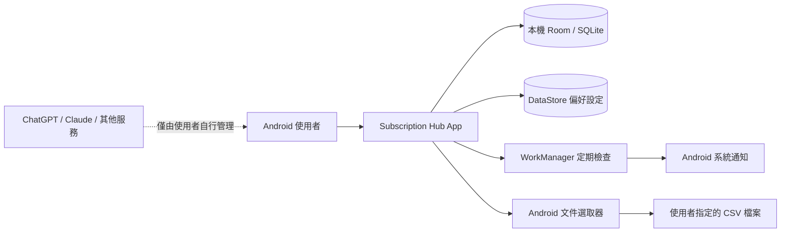
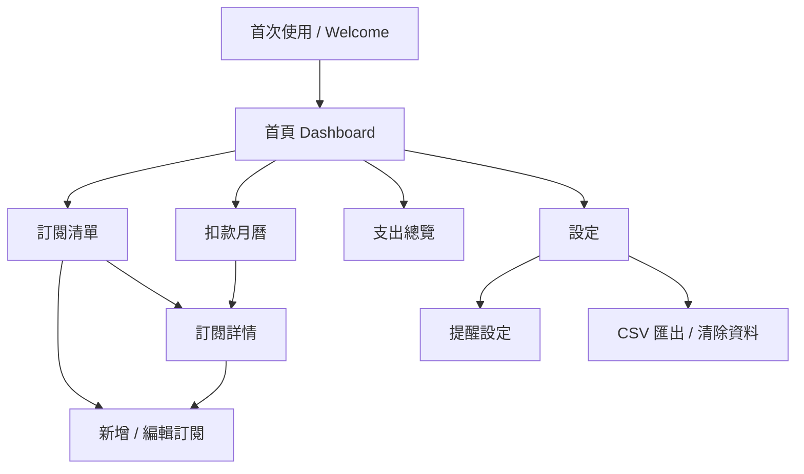
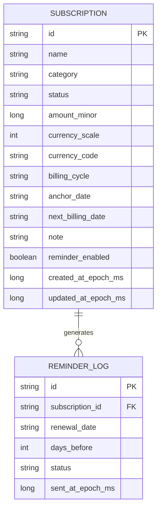
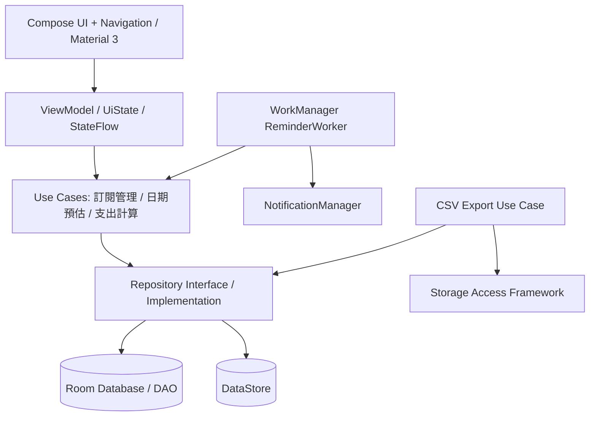
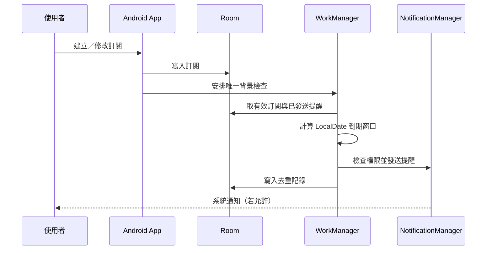

# Subscription Hub｜Android App 系統分析文件（SA）

> **System Analysis Document / Android Native MVP**  
> 文件版本：v1.0 ｜ 文件日期：2026-10-10 ｜ 專案：HowardAIStudio / Subscription Hub  
> 文件狀態：開發基準草案（待 Product Owner 確認） ｜ 語系：繁體中文（zh-TW）

---

## 0. 文件控制與決策摘要

| 項目 | 定義 |
|---|---|
| 產品名稱 | Subscription Hub（暫定，可更名） |
| 平台 | Android 原生 App；先手機版，版面支援平板／折疊螢幕基本自適應 |
| 核心目標 | 集中管理個人訂閱、預估扣款、到期提醒與資料匯出 |
| MVP 技術路線 | Kotlin、Jetpack Compose、Material 3、MVVM／單向資料流、Room、DataStore、WorkManager |
| 帳號／後端 | MVP 不強制登入、不建後端；資料以裝置本機為準 |
| 預設幣別與語系 | TWD、zh-TW；單筆訂閱可設定 ISO 4217 幣別 |
| 交付類型 | Google Play 可上架的 Android App 原始碼、測試與使用文件（上架須另行審核） |
| 主要營收策略 | MVP 免費驗證；Pro、AI、家庭共享、雲端同步均列後續版本 |
| 核心排除事項 | 不代扣款、不控制第三方服務扣款日、不直接變更第三方訂閱、不串接銀行或信箱 |

**已決定的設計基準：**「簡化上線成本」優先於「跨裝置同步」；「預估」與「實際扣款」必須區分；「月底／跨幣別」計算必須正確；提醒不可承諾秒級準時。

**待確認決策（不阻塞 MVP 原型）：** 正式 App 名稱、套件識別碼 `applicationId`、支援的最低 Android 版本、視覺品牌、通知預設開啟方式，以及是否於公開測試階段蒐集匿名事件分析。

## 1. 專案背景、問題與成功定義

### 1.1 現況與待解決問題

使用者同時訂閱 AI 工具、串流、雲端儲存及其他數位服務，續訂時間與價格分散於不同平台。常見問題包括：(1) 不清楚每月實際預計支出；(2) 遺忘續訂而錯過自行取消時機；(3) 多幣別與年度付款不容易比較；(4) 無法辨認重複或閒置訂閱。

### 1.2 MVP 成功定義

- 第一次使用者不建立帳號，也能在 2 分鐘內手動新增一筆訂閱（作為測試目標，不是已驗證的使用者行為）。
- 所有訂閱、支出總覽、扣款月曆在沒有網路時可正常查詢與修改。
- 日期、幣別、週期與提醒狀態在重新啟動 App 後仍正確保留。
- 不同幣別不在無匯率資料時直接相加；當月預計支付與月均攤提分開呈現。
- 裝置拒絕通知權限時，App 仍可使用，並清楚提示「系統通知未啟用」。
- 使用者能匯出含 UTF-8 BOM 的 CSV 並以一般試算表軟體開啟。

### 1.3 產品範圍

| 範圍 | MVP（P0） | 後續（P1/P2） |
|---|---|---|
| 訂閱 | 手動新增／編輯／停用／刪除；分類；幣別；週期 | 自訂計費週期、收據擷取、共用訂閱 |
| 觀測 | 首頁 Dashboard、列表、月曆、按幣別統計 | 趨勢報表、匯率換算、跨裝置分析 |
| 提醒 | 本機續訂前提醒；自訂提醒天數；去重 | 郵件／LINE／推播、同步提醒 |
| 資料攜出 | CSV 匯出；本機資料清除 | CSV 匯入、加密備份、雲端同步 |
| 日期規劃 | 展示續訂時間，不變更第三方帳單 | 官方平台指引與「目標集中扣款日」模擬 |
| 金流 | 不收取任何第三方訂閱款 | App 自身 Pro 內購／訂閱（需另行符合 Google Play 付款政策） |

## 2. 利害關係人與角色

| 角色 | 工作／目標 | 權限 |
|---|---|---|
| 一般使用者 | 管理本人在此 App 建立的訂閱與提醒 | 本機資料 CRUD、CSV 匯出、設定 |
| 產品管理者（PO） | 決定範圍、文案、定價與優先順序 | 產品規劃；MVP 無線上管理後台 |
| Android 開發者 | 實作 UI、資料層、計算與提醒 | 原始碼、測試、發行打包 |
| QA／驗收人員 | 驗證情境、邊界及資料正確性 | 測試版 App、測試案例 |

**MVP 不設伺服器管理者、使用者登入角色或家庭共享權限模型。**

## 3. 系統範圍與情境

### 3.1 系統脈絡圖



### 3.2 產品責任界線

本 App 管理的是**使用者自行記錄的訂閱資訊與預估續訂事件**。不具備第三方服務的扣款控制權、銀行查帳權或取消訂閱的代理權。日期可能因第三方調整、試用、稅額、匯率或使用者資訊過期而與實際帳單不同。相關頁面需標示「預估日期／預估金額」。

### 3.3 使用案例（Use Cases）

| ID | 案例 | 主要行為 | 例外處理 |
|---|---|---|---|
| UC-01 | 第一次開啟 | 說明產品、設定幣別與通知說明、進首頁 | 拒絕通知仍可繼續 |
| UC-02 | 新增訂閱 | 輸入名稱、金額、幣別、週期、下次續訂日 | 格式錯誤顯示欄位錯誤 |
| UC-03 | 編輯訂閱 | 修改金額、週期、日期、狀態 | 取消提醒重算、總覽即時更新 |
| UC-04 | 檢視月曆 | 點日期顯示當天預估扣款 | 無資料呈現空狀態 |
| UC-05 | 檢視報表 | 當月預計支出、月均成本、分類／幣別 | 不混加不同幣別 |
| UC-06 | 設定提醒 | 選 7／3／1／0 天、提醒時間及總開關 | 權限被拒絕時呈現說明 |
| UC-07 | 收到提醒 | 點通知開啟指定訂閱詳情 | 訂閱已刪除則回首頁 |
| UC-08 | 匯出 CSV | 以 Android 文件選取器選位置並存檔 | 取消、I/O 失敗均有訊息 |
| UC-09 | 刪除資料 | 確認刪除單筆或清除全部 | 刪除後撤銷未來提醒 |

## 4. Android 頁面與 UX 規格

### 4.1 資訊架構（Sitemap）



### 4.2 主要畫面規格

| 畫面 ID | 名稱 | 主要元件 | 操作 |
|---|---|---|---|
| SCR-01 | Welcome | 產品價值、資料只存在本機說明、開始按鈕 | 首次設定偏好；不強迫通知授權 |
| SCR-02 | Dashboard | 本月預估支出（依幣別）、30 天內到期筆數、近期清單、快速新增 | 開詳情、看月曆、看全部 |
| SCR-03 | 訂閱列表 | 搜尋、狀態／類別篩選、排序、訂閱卡片 | 新增、檢視、修改、停用 |
| SCR-04 | 新增／編輯 | 名稱、類別、金額、幣別、週期、日期、提醒、備註 | 儲存、取消、欄位檢核 |
| SCR-05 | 訂閱詳情 | 完整資訊、下次預估續訂、未來幾次日期、操作按鈕 | 編輯、取消續訂、刪除 |
| SCR-06 | 月曆 | 月份切換、標記扣款日、每日明細、幣別小計 | 點日期／項目開詳情 |
| SCR-07 | 報表 | 當月實付預估、月均等值、分類占比（限同幣別）、狀態 | 指定月份、匯出 |
| SCR-08 | 設定 | 首選幣別、提醒偏好、通知權限狀態、匯出、資料刪除、版本 | 開系統設定、匯出、清除 |

### 4.3 UI/UX 設計原則

1. **Material 3 + Jetpack Compose：** 跟隨系統深色／淺色模式，避免硬編碼尺寸與文字。
2. **繁體中文優先：** 日期如 `2026/10/15`；金額依 Locale 顯示，儲存格式不得依賴畫面字串。
3. **手機底部分頁：**「總覽／訂閱／月曆／報表」；設定由頁面操作進入。大螢幕可改為 Navigation Rail。
4. **空狀態清楚：** 沒有訂閱時顯示「開始新增第一筆訂閱」，而非空白圖表。
5. **揭露預估性質：** Dashboard 與月曆均使用「預計／預估」字樣，不寫「已扣款」。
6. **可及性：** 語意標籤、螢幕閱讀器可辨識、文字縮放不截斷、點擊範圍足夠、對比符合 Material 指引。

## 5. 功能需求（FR）

### 5.1 訂閱資料管理（P0）

| ID | 功能與系統行為 | 優先級 | 驗收對應 |
|---|---|---|---|
| FR-001 | 使用者可新增一筆訂閱，必填：名稱、金額、幣別、計費週期、下一次預估扣款日 | P0 | AT-01 |
| FR-002 | 訂閱名稱 1–80 字；備註最多 500 字；金額需大於 0 | P0 | AT-02 |
| FR-003 | 支援 MONTHLY、YEARLY、WEEKLY 三種週期；MVP 不處理日／季／不規則周期 | P0 | AT-03 |
| FR-004 | 幣別為 ISO 4217 代碼（至少 TWD、USD、JPY、EUR），以固定貨幣倍率保存金額，並記錄該筆儲存時的 currency_scale | P0 | AT-04 |
| FR-005 | 分類：AI、影音、雲端／儲存、軟體／工具、教育、其他；使用者可修改類別 | P0 | AT-05 |
| FR-006 | 可編輯訂閱、停用未來續訂、恢復啟用及刪除；刪除需確認 | P0 | AT-06 |
| FR-007 | 搜尋名稱；依下次日期、金額、名稱排序；依狀態／類別篩選 | P0 | AT-07 |
| FR-008 | 預設可建立多筆同名稱訂閱，不強制唯一；顯示重複提醒供使用者自行辨識 | P0 | AT-08 |

**狀態語意：** `ACTIVE`（繼續預估未來扣款）、`TRIAL`（試用，下一次為首次付費日期）、`PAUSED`（暫停，暫不預估扣款）、`CANCELLED`（已取消未來續訂，無預估後續扣款）、`ARCHIVED`（僅保留記錄，清單預設隱藏）。切換為 PAUSED/CANCELLED/ARCHIVED 時應取消未來提醒；恢復 ACTIVE 時必須重新確認續訂日。

### 5.2 金額與日期計算（P0）

| ID | 功能與規則 | 優先級 | 驗收對應 |
|---|---|---|---|
| FR-009 | 當月預計支付：依選定曆月列出到期事件，按**相同幣別**加總；年度訂閱只在續訂月份計入 | P0 | AT-09 |
| FR-010 | 月均等值：MONTHLY = 單次金額、YEARLY = 單次金額 ÷ 12、WEEKLY = 單次金額 × 52 ÷ 12；標記「估算值」 | P0 | AT-10 |
| FR-011 | 月末錨點：每期依原始計費錨點算出，超出月天數則落在該月最後一天；不得逐月以前一期的截短日期遞推 | P0 | AT-11 |
| FR-012 | 跨年與閏年：年繳 2/29 在非閏年落 2/28，閏年回 2/29；週繳依 7 日遞推 | P0 | AT-12 |
| FR-013 | 使用者自行記錄價格異動：編輯新價格預設只影響未來預估，不回填歷史已過月份 | P0 | AT-13 |
| FR-014 | 不換算不同幣別、不將 TWD+USD 顯示為單一數字；MVP 報表以幣別分組 | P0 | AT-14 |
| FR-015 | 所有日期為使用者認知的 LocalDate，不將 UTC Timestamp 當扣款日期儲存 | P0 | AT-15 |

**設計決策（重要）：** 若當期價格編輯後需保留歷史已顯示金額，MVP 應以 `billing_occurrence` 快照維護既有已過期間；但「實際已扣款」仍不代表真實銀行交易。更具體說，請勿把推算的歷史事件直接命名成已付款交易。首次版本可僅顯示「目前資料回推的歷史預估」，不宣稱歷史實付；若需鎖定歷史價格，需增加 BillingSnapshot 表並升級為 P1。**MVP 主畫面僅承諾從目前資料推算未來與本月預估。**

### 5.3 通知提醒（P0）

| ID | 功能與規則 | 優先級 | 驗收對應 |
|---|---|---|---|
| FR-016 | 可設定提醒提前天數（預設 7、3、1 天，可個別勾選；0 天可選） | P0 | AT-16 |
| FR-017 | 設定通知偏好時間（預設裝置當地 09:00；為偏好非保證準時時間） | P0 | AT-17 |
| FR-018 | 使用 WorkManager 執行持續性背景檢查、啟動／資料變更時立即重新計算 | P0 | AT-18 |
| FR-019 | 以 `(subscriptionId, renewalDate, daysBefore)` 作通知去重鍵，避免重複發送 | P0 | AT-19 |
| FR-020 | Android 13+ 動態取得 POST_NOTIFICATIONS；未允許仍保留 App 內待辦清單 | P0 | AT-20 |
| FR-021 | 點通知開啟對應詳情；已刪除則導向清單 | P0 | AT-21 |
| FR-022 | 使用者停用訂閱、刪除訂閱或關閉通知時，不能產生新的提醒；既有通知可由使用者清除 | P0 | AT-22 |

**交付限制：** WorkManager 受系統排程、Doze、省電管理影響，不保證在 09:00 整秒發出通知，也不保證裝置關機時仍能推播。MVP 不要求精確鬧鐘權限（`SCHEDULE_EXACT_ALARM` / `USE_EXACT_ALARM`）。如日後承諾準點提醒，須重新評估 Android 政策及排程設計。[R3][R4]

### 5.4 報表與匯出（P0）

| ID | 功能與規則 | 優先級 | 驗收對應 |
|---|---|---|---|
| FR-023 | Dashboard 顯示當月各幣別預估金額、接下來 30 天預計續訂項目 | P0 | AT-23 |
| FR-024 | 月曆查看指定月份預估扣款事件，同一天可列多筆 | P0 | AT-24 |
| FR-025 | 報表顯示各幣別月均等值、分類占比（各幣別分別計算） | P0 | AT-25 |
| FR-026 | 使用 Android Storage Access Framework `ACTION_CREATE_DOCUMENT` 匯出 CSV | P0 | AT-26 |
| FR-027 | CSV 為 UTF-8 BOM；採 RFC 4180 引號逃逸、避免公式注入（`=,+,-,@` 等風險前綴處理） | P0 | AT-27 |
| FR-028 | 使用者可清除全部本機資料，需二次確認並清除提醒去重記錄 | P0 | AT-28 |

**CSV 欄位：** `id,name,category,status,amount_minor,currency_scale,currency,cycle,anchor_date,next_billing_date,note,created_at,updated_at`。日期使用 ISO `YYYY-MM-DD`；金額欄位明確標示 minor units（例如 TWD 19900 代表 TWD 199.00；USD 999 代表 USD 9.99）。如額外匯出人類可讀金額，新增 `amount_display` 欄位，不可替換原始精確欄位。

## 6. 商業規則（BR）與演算法

### 6.1 續訂日期規則

| ID | 規則 | 範例 |
|---|---|---|
| BR-01 | 日期儲存為 ISO 本地日期，跟隨使用者手動輸入的計費日 | `2026-01-31` |
| BR-02 | MONTHLY 以錨點月份 + N 個月計算，每月套用原始日數 | 1/31→2/28→3/31；閏年 2/29 |
| BR-03 | YEARLY 以原始月、日生成未來每年日期；不存在的日子截至月末 | 2024/2/29→2025/2/28→2028/2/29 |
| BR-04 | WEEKLY 固定每 7 日；不以「每月 4 週」推導實際扣款次數 | 10/10→10/17→10/24 |
| BR-05 | 下一次扣款日應為使用者確認的預估日期，且進入未來計算需維持計費錨點，不自行跳過試用後的首筆 | 首次扣款需保留 |
| BR-06 | 任意月份報表以該月 1 日（含）到下月 1 日（不含）為事件範圍 | 10/01～10/31 |
| BR-07 | 狀態非 ACTIVE/TRIAL 的訂閱，不產生新的扣款事件 | PAUSED 不計入 |
| BR-08 | 同日多筆不同幣別不相加，分組顯示 | TWD 299、USD 20 分行 |
| BR-09 | 金額以固定 decimal scale 儲存，並一併保存 scale；展示精度可依設定及幣別規則決定；禁止浮點數承載原始貨幣 | JPY scale 0；USD/TWD scale 2。勿單靠可變動的 ICU 預設精度重建歷史資料 |
| BR-10 | 試用期不計入現在已付；首次收費日到達時視為預估付費事件 | 試用到 11/01 才開始 |

**邊界規則：** 若使用者設定的 `next_billing_date` 與錨點不符合，保留使用者輸入作本次預估日期，未來週期以該日期作新的錨點；系統須要求二次確認，避免錯位。建立當下必須明確區分「計費錨點」與「下一次預估扣款日」；MVP 表單可簡化為「下一次預估扣款日」，儲存時同步設為錨點。

### 6.2 預估支出規則

- **當月預估支付** = 該曆月內所有有效續訂事件的金額總和（按幣別）；不代表銀行扣款成功。
- **月均等值** = 將目前持續有效的週期性訂閱換算成平均每月負擔；屬比較指標，不是指定月份的實付預測。
- **年均等值** = MONTHLY × 12；YEARLY × 1；WEEKLY × 52；為簡化年度化估算，並非精確自然年度扣款次數。
- **匯率** = MVP 不提供。跨幣別統一報表屬 P1，需要資料來源、匯率時間戳、參考匯率／實際發卡機構費率差異揭露。

## 7. 資料模型與 ERD

### 7.1 實體定義

**Subscription（核心訂閱）**

| 欄位 | 型別 | 規則 |
|---|---|---|
| `id` | TEXT (UUID) | PK，不可為空 |
| `name` | TEXT | 必填、1–80 字 |
| `category` | TEXT | 指定分類 enum |
| `status` | TEXT | ACTIVE / TRIAL / PAUSED / CANCELLED / ARCHIVED |
| `amount_minor` | INTEGER (Long) | > 0；固定倍率整數，檢查溢位 |
| `currency_scale` | INTEGER | 精度倍率小數位數；例如 TWD/USD=2、JPY=0，寫入時明確保存 |
| `currency_code` | TEXT | ISO 4217（3 字元） |
| `billing_cycle` | TEXT | WEEKLY / MONTHLY / YEARLY |
| `anchor_date` | TEXT | `YYYY-MM-DD`；保留原始錨點 |
| `next_billing_date` | TEXT | `YYYY-MM-DD`；使用者確認的下一次預估扣款日 |
| `note` | TEXT? | 最多 500 字 |
| `reminder_enabled` | INTEGER | 0 或 1 |
| `created_at_epoch_ms` | INTEGER | UTC Instant epoch 毫秒（資料稽核用途） |
| `updated_at_epoch_ms` | INTEGER | UTC Instant epoch 毫秒 |

**ReminderLog（本機通知去重）**

| 欄位 | 型別 | 規則 |
|---|---|---|
| `id` | TEXT (UUID) | PK |
| `subscription_id` | TEXT | FK → Subscription.id，刪除時級聯 |
| `renewal_date` | TEXT | `YYYY-MM-DD` |
| `days_before` | INTEGER | 0 / 1 / 3 / 7 等設定值 |
| `sent_at_epoch_ms` | INTEGER | 傳送嘗試完成時間 |
| `status` | TEXT | SENT / SKIPPED_PERMISSION / ERROR |
| UNIQUE | 複合索引 | (`subscription_id`,`renewal_date`,`days_before`) |

**AppSettings（DataStore）**：`locale`、`default_currency`、`reminder_days`、`reminder_local_time`、`notifications_enabled`、`theme_mode`、`onboarding_done`、`privacy_analytics_opt_in`。

### 7.2 邏輯 ERD



**未來版本保留：** `BillingSnapshot`（已確認的預估／人工實付紀錄）、`ReceiptImport`（收據辨識審核）、`UserAccount`（登入同步）、`ServiceGuide`（第三方官方指引）均不在 MVP 建表。

## 8. 技術架構（Android Native）

### 8.1 元件分層



### 8.2 技術選型

| 元件 | 建議 | 選型原因 |
|---|---|---|
| 程式語言 | Kotlin | Android 官方優先技術方向 |
| UI | Jetpack Compose + Material 3 | 原生、元件化、支援自適應布局 |
| 架構 | MVVM + UDF + Repository | UI 狀態與資料運算分離，便於測試 |
| 非同步 | Kotlin Coroutines + Flow | 非同步與資料更新訂閱 |
| 結構化本機資料 | Room | SQLite 抽象層、查詢檢核及 migration |
| 使用者偏好 | Preferences DataStore | 少量鍵值設定 |
| 排程 | WorkManager | 耐重啟、裝置重開機後仍能執行可延後工作 |
| DI | Hilt（建議） | 降低依賴組裝成本；可選用手動 DI 以縮小 MVP |
| 日期與金額 | `java.time`、Long、BigDecimal | 正確處理日期與貨幣精度 |
| 檔案匯出 | Android Storage Access Framework | 使用者指定輸出位置，不需廣泛儲存權限 |
| 測試 | JUnit + Compose UI Test + Room Integration | 覆蓋日期、計價、資料持久化、導航 |

**版本原則：** Gradle、Kotlin、Compose BOM、Room 與 Android Gradle Plugin 版本於建立專案當日，依 Google 官方相容矩陣固定並提交 lock/config；本 SA 不硬指定容易過期的版本號。[R1][R2][R5]

### 8.3 建議套件結構

```text
app/src/main/java/<package>/
  MainActivity.kt
  SubscriptionHubApp.kt
  core/
    currency/        # 金額格式與幣別小數位
    datetime/        # 週期日期引擎
    ui/              # 共用元件與 Design System
    notification/    # 通知權限與 Channel
    export/          # CSV encoder / SAF
  data/
    local/            # Room entities, DAO, migration
    preferences/      # DataStore
    repository/       # RepositoryImpl
  domain/
    model/            # 非 Android domain model
    repository/       # Interfaces
    usecase/          # CRUD / Forecast / Report / Reminder
  feature/
    onboarding/
    dashboard/
    subscription/
    calendar/
    report/
    settings/
  worker/
    ReminderWorker.kt
  navigation/
    AppNavGraph.kt
app/src/test/         # 日期、金額、領域規則單元測試
app/src/androidTest/  # DAO / UI / Activity 行為測試
```

## 9. 通知系統詳細分析

### 9.1 觸發流程



### 9.2 排程規範

1. 首次啟動或開啟提醒時，建立**唯一的** PeriodicWork（建議日常巡檢），避免重複排程。
2. 訂閱 CRUD 或提醒設定變更後，觸發 OneTimeWork 重新檢查，並以唯一工作策略合併重複請求。
3. 每次掃描以裝置目前 `LocalDate` 判斷事件，不依賴 Worker 剛好在設定的時間執行。
4. 到期前 D-7/D-3/D-1/D0 各有獨立去重鍵；若系統數日未允許執行，**不補發已錯過的所有舊提醒**，只顯示 App 內即將到期／逾期事件。
5. 通知權限未授予，不顯示系統通知；`ReminderLog` 的 `SKIPPED_PERMISSION` 記錄不得讓未來授權後永遠失去符合條件的新提醒機會（只把真正 SENT 視為已送達去重）。
6. 時區與系統日期變更後重新計算預估提醒；測試時需確認過午夜、跨時區及 DST 地區結果。
7. App 被系統強制停止（force-stop）或長期受省電影響時，通知可能不發；畫面須有 App 內提醒替代。

### 9.3 通知文案範例

- 標題：`訂閱即將續訂：ChatGPT Plus`
- 內容：`預計 3 天後（10/13）續訂，金額 USD 20.00。請以服務商帳單為準。`
- 點擊：`subscription/{id}`；不在鎖定畫面顯示不必要的敏感詳細備註。

## 10. 資料流、儲存與資安

### 10.1 資料流

1. 使用者在 Compose 畫面輸入資料。
2. ViewModel 檢核必填、數值與日期格式。
3. UseCase 統一執行領域規則與 CRUD，Repository 寫入 Room。
4. Room Flow 讓 Dashboard、列表與報表更新。
5. WorkManager 從 Room 讀取資料產生本機提醒。
6. 匯出時在記憶體串流產生 CSV，經 SAF 寫入使用者指定的 URI。

### 10.2 資料最小化與權限

| 項目 | MVP 設計要求 |
|---|---|
| 銀行帳號／信用卡／密碼 | 不收集、不儲存 |
| 信箱讀取、簡訊讀取 | 不要求權限、不讀取 |
| 網路連線 | 核心功能不依賴網路；MVP 不導入非必要追蹤 SDK |
| 通知權限 | Android 13+ `POST_NOTIFICATIONS`，按功能情境詢問 |
| 檔案存取 | 使用 SAF，不要求廣泛檔案讀寫權限 |
| 本機資料 | 私有 App sandbox；敏感日誌不得包含使用者備註與完整收據 |
| 備份 | MVP 明定不提供跨裝置恢復；需審核 Android 系統備份設定，避免隱性同步與使用者認知不符 |
| 刪除 | App 內可刪除全部本機資料；外部已匯出 CSV 需由使用者自行管理 |
| 傳輸 | MVP 無第三方傳輸；如引入分析 SDK 或後端，另行更新隱私聲明與 Data safety |

**資料安全說明：** Android 應用私有儲存不等於裝置遭入侵時的絕對保密。若增加憑證、帳號或雲端同步，需設計 Android Keystore、加密、身分驗證、備份策略與服務端授權。

### 10.3 Google Play 上架合規

- App 上架前須提供與實際蒐集及分享資料一致的隱私政策，填寫 Google Play Data safety 表單；即便無蒐集資料也須依 Console 的表單要求如實聲明。[R7]
- 後續若在 Google Play 分發的 App 內銷售 Pro 數位功能，原則上需符合 Google Play Billing 政策；適用例外及地區方案須在上架前依最新政策核對。[R8]
- 不將「可控制第三方訂閱扣款日」「已替使用者取消訂閱」「真實扣款成功」用於介面或行銷文案。

## 11. 非功能需求（NFR）

| ID | 分類 | 需求／初步驗收目標 |
|---|---|---|
| NFR-01 | 平台 | Android 原生；最低 SDK 版本於 kickoff 決定並固定；目標 SDK 遵守上架當期要求 |
| NFR-02 | 可用性 | 無網路可完成訂閱 CRUD、月曆、報表與匯出 |
| NFR-03 | 效能 | 測試資料 1,000 筆下 Dashboard 首次資料繪製目標 < 2 秒（測試機規格需固定） |
| NFR-04 | 穩定性 | 不因通知權限拒絕、文件選取取消或資料為空而閃退 |
| NFR-05 | 一致性 | 所有畫面使用同一套日期、幣別與計費算法 |
| NFR-06 | 可測試性 | 核心日期與貨幣計算純 Kotlin，不依賴 Android Context |
| NFR-07 | 可維護性 | UI/Domain/Data 分層；Room schema version 與 migration 測試納入 CI |
| NFR-08 | 安全 | 僅要求必要權限；不把使用者訂閱清單輸出到一般 Logcat |
| NFR-09 | 國際化 | 介面先 zh-TW，採 string resources；日期及金額不硬編碼 |
| NFR-10 | 無障礙 | 可用 TalkBack、字體放大、適當對比與觸控尺寸操作 |
| NFR-11 | 發行 | Release AAB 可建置、簽署流程文件化、Debug/Release 設定分離 |

> 註：效能門檻屬專案驗收目標，非已實測數據；開發時建立基準裝置與量測方法。

## 12. 驗收測試案例（AT）

| ID | 測試步驟／輸入 | 預期結果 |
|---|---|---|
| AT-01 | 新增 ChatGPT Plus，USD 20.00，MONTHLY，下次 2026-10-15 | 儲存成功，列表顯示正確日期與幣別 |
| AT-02 | 輸入空名稱、0 元、非法幣別或不合法日期 | 阻止儲存並顯示欄位錯誤 |
| AT-03 | 新增 WEEKLY/MONTHLY/YEARLY 各一筆 | 可依規則生成後續事件 |
| AT-04 | USD 9.99、JPY 1000、TWD 199 | 分別存 amount_minor 999/1000/19900，對應 scale 2/0/2，並正確顯示 |
| AT-05 | 對訂閱變更分類 | 列表及分類統計同步更新 |
| AT-06 | 暫停／取消／刪除訂閱 | 未來扣款預估與提醒排除該項 |
| AT-07 | 搜尋名稱、排序、篩選 | 結果、排序及空狀態正確 |
| AT-08 | 建立兩筆同名稱不同金額訂閱 | 可儲存；呈現重複提示不阻止 |
| AT-09 | 年繳 TWD 1200，續訂在 11 月，查看 10 月 | 10 月當月預估支付不納入該筆 |
| AT-10 | 年繳 TWD 1200 | 月均等值 TWD 100（但 10 月未扣款時本月預估為 0） |
| AT-11 | MONTHLY 錨點 2027-01-31 | 2027-02-28、2027-03-31（非 3/28） |
| AT-12 | YEARLY 錨點 2024-02-29 | 2025-02-28、2028-02-29 |
| AT-13 | 修改未來價格、查詢歷史資料 | 不出現「歷史實際付款」的不實宣稱 |
| AT-14 | 同時有 TWD 299 與 USD 20 | 呈現兩個幣別小計，不產生「319 元」 |
| AT-15 | 將裝置時區從台北切換倫敦 | 訂閱日期 LocalDate 不無故移前一天 |
| AT-16 | 設提醒 D-7/D-3/D-1 | 符合日期窗口者可產生各自通知 |
| AT-17 | 設定 09:00 提醒，啟用省電 | 文案標註非精確保證，App 內待辦仍顯示 |
| AT-18 | 重新開機、重新開啟 App | WorkManager 工作持續存在並可重新檢查 |
| AT-19 | 重複觸發 Worker 兩次 | 同 `(id,date,dayOffset)` 不重複推送 SENT 通知 |
| AT-20 | Android 13+ 拒絕通知權限 | 核心功能可用，畫面顯示權限未開啟 |
| AT-21 | 點通知；其後刪除訂閱再點舊通知 | 正常導航，不崩潰 |
| AT-22 | 暫停該筆訂閱 | 後續掃描不再發送該筆提醒 |
| AT-23 | 30 天內兩筆預計續訂 | 首頁按日期排列且以預估文字呈現 |
| AT-24 | 月曆同日三筆續訂 | 全部顯示並可點開各項詳情 |
| AT-25 | USD 與 TWD 分類統計 | 不跨幣別直接計算共同占比 |
| AT-26 | 匯出 CSV，使用者在文件選取器取消 | 不建立檔案、不崩潰、不宣稱成功 |
| AT-27 | 訂閱名稱有逗號、引號、換行、`=1+1` | CSV 正確轉義且試算表不執行公式 |
| AT-28 | 清除全部資料並重開 App | Room 資料與 ReminderLog 為空 |
| AT-29 | 斷網狀態下執行 CRUD、月曆、匯出 | 全部正常，不需要登入 |
| AT-30 | 模擬 1,000 筆訂閱、旋轉及折疊螢幕切換 | 無崩潰，關鍵資訊可讀且可操作 |

### 12.1 測試分層

- Unit：`RecurringDateCalculator`、`MoneyFormatter`、`ForecastCalculator`、`CsvEncoder`。
- DAO：資料增刪改查、過濾、外鍵與 migration。
- UI：空狀態、權限拒絕、表單檢核、導航及橫直向。
- 系統整合：省電模式／通知關閉、重開機、SAF 取消、無網路。
- 回歸測試：新增欄位或更新 Room 版本時不遺失既有訂閱。

## 13. 開發工作分解（Codex / Sprint Backlog）

| Wave | 工作包 | 產出 | 依賴 |
|---|---|---|---|
| W0 | 專案初始化 | Kotlin Compose 專案、Design System、CI 測試骨架 | 無 |
| W1 | 核心 Domain | 資料模型、金額／續訂日期引擎、單元測試 | W0 |
| W2 | Local Data | Room Entities/DAO、Repository、DataStore、Migration 基線 | W1 |
| W3 | 訂閱管理 | 訂閱列表、CRUD、詳情、分類、搜尋與驗證 | W2 |
| W4 | 儀表板／月曆／報表 | Forecast UseCase、Home、Calendar、Reports | W3 |
| W5 | 提醒 | WorkManager、Notification Channel、通知權限／去重／深連結 | W4 |
| W6 | CSV／設定 | SAF 匯出、提醒選項、資料刪除、隱私資訊 | W2–W5 |
| W7 | QA 與 Release | Unit/UI/Integration、Accessibility、AAB、上架文件 | 全部 |

**執行原則：** 先完成 W1「純計算可驗證」，再做 UI。不要先接 Firebase、後端帳號、支付或 AI OCR，避免 MVP 範圍失控。

### 13.1 Codex Definition of Done

一個工作包只有在同時滿足以下條件時才算完成：

1. 功能可在 Android Studio／Gradle 原始碼專案編譯。
2. 相關單元測試存在且通過；核心日期與金額演算法具邊界案例。
3. 新增 Room 欄位有 migration 路徑，不允許以破壞性遷移取代正式升級。
4. Compose 畫面有載入、空值、錯誤、成功狀態。
5. 權限拒絕及無網路環境不崩潰。
6. README 有執行方法、功能狀態、已知限制與下一步。

## 14. 後續功能擴展（MVP 外）

| 階段 | 功能 | 前置分析 |
|---|---|---|
| P1 | 第三方訂閱調整官方指引 | 指引來源驗證、維護機制、更新日期 |
| P1 | 集中扣款日模擬 | 只能「規劃」，不可偽稱直接修改服務商扣款 |
| P1 | CSV 匯入 | 重複資料比對、欄位版本、惡意內容處理 |
| P1 | 收據 OCR / AI 擷取 | 使用者明確授權、資料最小化、錯誤校對與處理位置 |
| P1 | 匯率換算 | 匯率 API、快取、來源、更新時間與費率揭露 |
| P2 | 帳號／雲端同步 | OAuth、身分驗證、資料同步衝突、刪除權與備份 |
| P2 | 家庭共享 | 擁有者、成員、欄位權限、退出與撤權 |
| P2 | Pro 訂閱 | Google Play Billing、權益驗證、恢復購買、退費與合規 |
| P2 | 多平台 App | 在 Android Domain API 穩定後再評估 Web/iOS |

## 15. 風險矩陣與因應

| 風險 | 影響 | 因應措施 |
|---|---|---|
| 系統延遲背景任務 | 提醒無法保證準點 | WorkManager + App 內到期清單 + 明確文案 |
| 使用者未更新第三方價格 | 預估與真實帳單差異 | 所有金額標示為「預估」；手動編輯簡便 |
| 月底續訂演算法錯誤 | 預估日期錯誤 | 保留錨點；單元測試 29/30/31、閏年 |
| 跨幣別直接相加 | 支出誤導 | MVP 僅依幣別分組；P1 才導入匯率 |
| 資料刪除／換機遺失 | 使用者資料無法復原 | 明示 local-only、可手動匯出 CSV |
| 公開上架政策變更 | 審核失敗／違規 | 上架前重新檢查 target SDK、Data safety、Billing |
| 功能蔓延 | 無法推出 MVP | P0/P1/P2 區隔；新增需求需 PO 審查 |

## 16. 開發前待確認事項（Decision Register）

| ID | 待確認事項 | 本版預設 | 最終決策人 |
|---|---|---|---|
| D-01 | App 正式名稱與圖示 | Subscription Hub（工作名稱） | PO |
| D-02 | Android 最低 API | 開工時依測試裝置與覆蓋率決定；本版不鎖定 | PO / Android Lead |
| D-03 | 套件識別碼 | `com.howardaistudio.subscriptionhub`（提案） | PO |
| D-04 | 暗色／亮色視覺 | Material 3，追隨系統 | PO / Design |
| D-05 | 匿名產品分析 | MVP 預設不整合第三方追蹤 | PO / Privacy |
| D-06 | App 備份／換機策略 | MVP 不提供同步，明示資料風險 | PO / Android Lead |
| D-07 | 週繳支援 | MVP 納入 | PO |
| D-08 | 分類是否允許自訂 | MVP 固定分類，其他可填備註 | PO |
| D-09 | 續訂時間格式 | 使用日期與使用者提醒時刻，不收真正扣款時刻 | PO |

## 17. 首版交付檢核表

- [ ] 原生 Android 原始碼可獨立編譯與安裝。
- [ ] 訂閱 CRUD、分類、搜尋、狀態可正常操作。
- [ ] Room + DataStore 資料持久化且可升版。
- [ ] 月底、閏年、週繳與各貨幣單位單元測試通過。
- [ ] Dashboard、月曆、報表內容均標明「預估」。
- [ ] 多幣別分開呈現，沒有不合理合併總計。
- [ ] 通知允許／拒絕／背景延遲情境通過。
- [ ] CSV 匯出可成功，且可取消與錯誤處理。
- [ ] 清除資料與通知取消／去重機制通過。
- [ ] 離線使用、字體縮放與基本折疊裝置版面測試通過。
- [ ] README、隱私政策、Data safety 資訊完成上架前審查。
- [ ] Release AAB 與簽章管理流程完成。

## 18. 官方技術參考與商業依據

> 下列連結為 2026-10-10 文件撰寫時核對之官方技術／政策頁面；正式上架前必須再次查核生效政策。

- **[R1] Android Developers — Android is Compose-first：** https://developer.android.com/develop/ui/compose/first
- **[R2] Android Developers — Save data in a local database using Room：** https://developer.android.com/training/data-storage/room
- **[R3] Android Developers — Task scheduling / WorkManager：** https://developer.android.com/develop/background-work/background-tasks/persistent
- **[R4] Android Developers — Define work requests / periodic timing：** https://developer.android.com/develop/background-work/background-tasks/persistent/getting-started/define-work
- **[R5] Android Developers — DataStore：** https://developer.android.com/topic/libraries/architecture/datastore
- **[R6] Android Developers — Notification runtime permission：** https://developer.android.com/develop/ui/compose/notifications/notification-permission
- **[R7] Google Play Console Help — Data safety：** https://support.google.com/googleplay/android-developer/answer/10787469
- **[R8] Google Play Console Help — Payments policy：** https://support.google.com/googleplay/android-developer/answer/9858738
- **[R9] Android Developers — Storage Access Framework：** https://developer.android.com/training/data-storage/shared/documents-files
- **[R10] Android Developers — Offline-first app architecture：** https://developer.android.com/topic/architecture/data-layer/offline-first
- **[R11] Android Developers — Schedule alarms / precise alarm restrictions：** https://developer.android.com/develop/background-work/services/alarms
- **[R12] Android Developers — Currency.getDefaultFractionDigits（不可用來決定資料庫保存倍率）：** https://developer.android.com/reference/android/icu/util/Currency

---

**版本說明：** v1.0 為 Android 原生 MVP 的 SA 開發基準草案，供 Codex／工程師據以建立工作包與測試案例。本文的效能與使用體驗目標屬設計要求，並非已完成開發或測試的事實。
